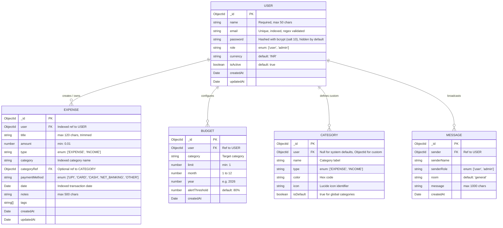

# 🗄️ Database Schema & Architecture Documentation

This document describes the MongoDB database design, Mongoose models, validation rules, relationship handling, indexing strategies, and aggregation pipelines implemented in **ExpenseTracker PRO**.

---

## 1. Entity Relationship (ER) Diagram



---

## 2. Model Specifications & Validation Rules

### A. User Model (`server/src/models/User.js`)
* **Email Validation**: Enforced via regex: `/^\w+([.-]?\w+)*@\w+([.-]?\w+)*(\.\w{2,3})+$/`
* **Password Hashing**: Pre-save hook using `bcryptjs` with salt round factor 10. `select: false` protects the hash from leaking into query responses.
* **Role-Based Access**: Role field is constrained to `['user', 'admin']` with default `'user'`.

### B. Expense Model (`server/src/models/Expense.js`)
* **Numeric Boundary Validation**: `min: [0.01, 'Amount must be greater than zero']`
* **Compound Indexes**:
  1. `{ user: 1, date: -1 }`: Optimizes user transaction history lookups and date range sorting.
  2. `{ user: 1, type: 1, date: -1 }`: Accelerates income vs. expense filtering.
  3. `{ user: 1, category: 1 }`: Optimizes category aggregation queries.

### C. Budget Model (`server/src/models/Budget.js`)
* **Uniqueness Index**: `{ user: 1, category: 1, month: 1, year: 1 }` with `{ unique: true }`. Prevents duplicate budget definitions for the same category in the same month.
* **Threshold Alert**: Default trigger at `80%` spend.

---

## 3. Aggregation Pipelines & Query Optimization

### Cash Flow Analytics Pipeline
```javascript
const totals = await Expense.aggregate([
  { $match: { user: userId } },
  {
    $group: {
      _id: '$type',
      total: { $sum: '$amount' },
      count: { $sum: 1 },
    },
  },
]);
```

### Category Breakdown Pipeline
```javascript
const categoryBreakdown = await Expense.aggregate([
  { $match: { user: userId, type: 'EXPENSE' } },
  {
    $group: {
      _id: '$category',
      total: { $sum: '$amount' },
      count: { $sum: 1 },
    },
  },
  { $sort: { total: -1 } },
]);
```
