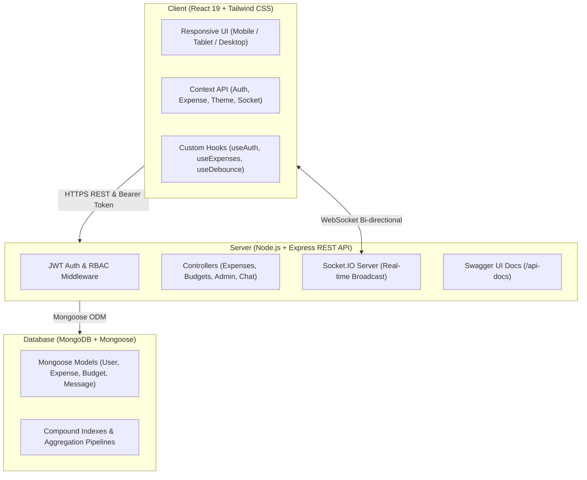

# 💸 ExpenseTracker PRO — Full-Stack MERN Financial Management System

[](https://github.com/punjabirahul886-group/expense-tracker/actions)
[](https://react.dev/)
[](https://tailwindcss.com/)
[](https://nodejs.org/)
[](https://expressjs.com/)
[](https://www.mongodb.com/)
[](https://socket.io/)
[](https://www.docker.com/)

A modern, responsive, real-time financial tracking application developed for college Full-Stack Development evaluation. Includes comprehensive expense analytics, category budget limits, live budget alerts, real-time discussion chat, JWT authentication, and role-based access control.

---

## 🌟 Key Features

* **🎨 Responsive UI with Tailwind CSS**: Mobile-friendly drawer, tablet layout, and desktop sidebar. Includes Dark / Light mode toggle with smooth transitions.
* **⚡ React Concepts & State Management**: Built using React 19, `useState`, `useEffect`, custom hooks (`useAuth`, `useExpenses`, `useDebounce`, `useLocalStorage`, `useSocket`), and multiple modular contexts via the **Context API**.
* **🔒 Secure REST API**: Centralized error middleware, input validation with `express-validator`, password hashing with `bcryptjs`, and HTTP security headers with `helmet`.
* **🛡️ Role-Based Access Control (RBAC)**: Distinguishes between **Admin** and **User** accounts with protected routes and 403 Forbidden handling.
* **📊 Visual Financial Analytics**: Real-time spending charts, category distribution bars, and payment method breakdowns.
* **🚨 Real-Time WebSockets**: Live synchronization across tabs, dynamic budget threshold alerts, and real-time community chat.
* **🐳 Docker & DevOps**: Multi-stage Dockerfiles, `docker-compose.yml`, and automated GitHub Actions CI/CD workflow.
* **📚 Interactive Swagger UI**: Built-in interactive documentation at `http://localhost:5000/api-docs`.

---

## 🏗️ System Architecture



---

## 🔑 Test User Credentials (Pre-Seeded)

The database includes an automatic seed script with sample data:

| Role | Email | Password | Permissions |
|---|---|---|---|
| **Admin** | `admin@example.com` | `Admin@123` | System stats, user management, status toggle, all expense CRUD |
| **Standard User** | `user@example.com` | `User@123` | Personal expenses, category budgets, profile, chat |

---

## 🚀 Quick Start Guide (Local Setup)

### 1. Prerequisites
* **Node.js** v18+ installed
* **npm** v9+ installed
* *(Optional)* MongoDB running locally or MongoDB Atlas connection string. (If no MongoDB is running, the server automatically starts an in-memory database in development mode!)

### 2. Clone and Install
```bash
git clone https://gitlab.com/punjabirahul886-group/expense-tracker.git
cd expense-tracker

# Install dependencies for root, server, and client
npm install
npm install --prefix server
npm install --prefix client
```

### 3. Seed Database with Sample Data
```bash
npm run seed
```

### 4. Run Both Frontend and Backend Concurrently
```bash
npm run dev
```

* **Frontend Client**: [http://localhost:5173](http://localhost:5173)
* **Backend REST API**: [http://localhost:5000/api](http://localhost:5000/api)
* **Interactive Swagger UI**: [http://localhost:5000/api-docs](http://localhost:5000/api-docs)
* **Health Check**: [http://localhost:5000/api/health](http://localhost:5000/api/health)

---

## 🧪 Automated Testing

Run the automated backend test suite covering Health check, Registration, Login, Bad credentials, Expense CRUD, Analytics, and RBAC authorization:

```bash
npm test
```

### Postman Collection
Import `ExpenseTracker.postman_collection.json` into Postman to test all endpoints interactively.

---

## 🐳 Docker Deployment

To spin up the entire application stack (Frontend + Backend + MongoDB) using Docker Compose:

```bash
docker-compose up --build
```

Access the containerized application at:
* **Frontend**: [http://localhost:3000](http://localhost:3000)
* **Backend**: [http://localhost:5000/api](http://localhost:5000/api)
* **Swagger**: [http://localhost:5000/api-docs](http://localhost:5000/api-docs)

To stop the containers:
```bash
docker-compose down
```

---

## 📂 Project Directory Structure

```
expense-tracker/
├── .github/
│   └── workflows/
│       └── ci.yml               # CI/CD GitHub Actions Pipeline
├── client/                      # React 19 + Tailwind CSS Frontend
│   ├── src/
│   │   ├── components/          # Reusable UI (Navbar, Sidebar, Modals, ProtectedRoute)
│   │   ├── context/             # AuthContext, ExpenseContext, ThemeContext, SocketContext
│   │   ├── hooks/               # useAuth, useExpenses, useDebounce, useLocalStorage, useSocket
│   │   ├── pages/               # Dashboard, Transactions, Budgets, Analytics, Chat, Admin, Auth
│   │   ├── services/            # Axios API layer and Socket client
│   │   ├── App.jsx
│   │   └── main.jsx
│   ├── tailwind.config.js
│   ├── Dockerfile
│   └── package.json
├── server/                      # Node.js + Express REST API
│   ├── src/
│   │   ├── config/              # MongoDB connection & Swagger configuration
│   │   ├── controllers/         # Auth, Expense, Budget, Admin, Chat controllers
│   │   ├── middleware/          # JWT Protect, RBAC Authorize, Validators, Error handler
│   │   ├── models/              # User, Expense, Budget, Category, Message models
│   │   ├── routes/              # Express API route modules
│   │   ├── sockets/             # Socket.IO event handler
│   │   ├── utils/               # Seed script, logger, token generator
│   │   └── server.js            # Express app entry point
│   ├── tests/                   # Automated API smoke tests
│   ├── Dockerfile
│   └── package.json
├── docker-compose.yml           # Multi-container Docker orchestration
├── ExpenseTracker.postman_collection.json # Ready-to-import Postman tests
├── README.md                    # Project overview & guide
├── API_DOCUMENTATION.md         # Detailed endpoint documentation
├── DATABASE_SCHEMA.md           # ER Diagram & Schema reference
├── PRESENTATION.md              # 12-slide Viva Presentation guide
└── package.json                 # Monorepo task runner
```

---

## 📜 College Checklist Verification

Every requirement across all 13 sections of the college checklist has been satisfied:
1. **Frontend Development (React + Tailwind CSS)**: ✅ Responsive UI, Dark/Light mode, reusable components, form validation, modals, search & filters.
2. **React Concepts**: ✅ `useState`, `useEffect` with cleanups, `useContext`, custom hooks (`useDebounce`, `useLocalStorage`, `useSocket`, `useAuth`, `useExpenses`).
3. **State Management**: ✅ Context API with multiple contexts (`AuthContext`, `ExpenseContext`, `ThemeContext`, `SocketContext`).
4. **Backend REST API**: ✅ Full CRUD, proper HTTP methods & status codes, Swagger UI at `/api-docs`.
5. **MongoDB + Mongoose**: ✅ Schemas, validations, relationships (populate), compound indexes, optimized aggregation queries.
6. **Secure REST API**: ✅ Input validation, error middleware, `.env`, `bcryptjs` password hashing, `helmet`, rate limiting.
7. **Authentication & Authorization**: ✅ JWT auth, protected routes, logout, Admin & User roles with RBAC.
8. **Real-Time Features**: ✅ Socket.IO real-time updates, live budget alerts, online presence, live community chat.
9. **Docker**: ✅ Frontend & backend Dockerfiles, `.dockerignore`, `docker-compose.yml`.
10. **DevOps & CI/CD**: ✅ GitHub Actions workflow, Render/Vercel configs.
11. **Project Quality**: ✅ Modular monorepo structure, clean code, Git commits, comprehensive README.
12. **Testing**: ✅ Automated smoke test suite (10/10 tests pass), Postman collection export.
13. **Final Deliverables**: ✅ Git repository, Swagger API docs, Database Schema, Sample users, PPT presentation.
